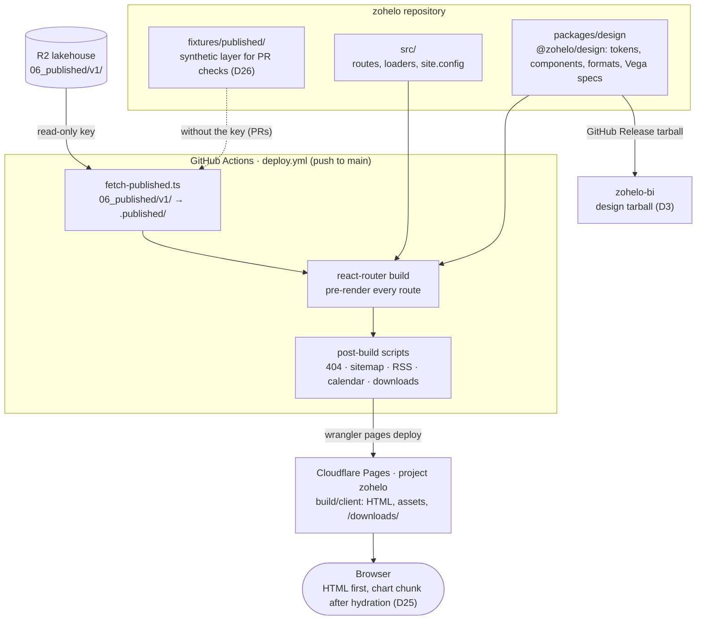

# zohelo.com: architecture

The public brand site ("Polska w danych / Poland in data") in the repository
[zohelo/zohelo](https://github.com/zohelo/zohelo). This view is the Architect's (docs/team.md, Architect; O20): current
state, target state, the gap, and the fitness checks that keep the site on the target. The platform overview is
[../architecture.md](../architecture.md); the published contract it reads is [../published.md](../published.md).

## Current state

- **Static, pre-rendered site.** React Router 7 in framework mode with `ssr: false` and `prerender()`
  (`react-router.config.ts`): every page in `src/site.config.ts` in Polish (`/…`) and English (`/en/…`), one page per
  published KPI (`/indicators/<kpi_key>`), per voivodeship (`/regions/…`) and per portfolio case study, plus 404.
  No server code at request time, no Pages Functions.
- **Data at build time only.** `scripts/fetch-published.ts` copies `06_published/v1/` (catalog, `kpi/*/latest.json`,
  `kpi/*/series.parquet`, `geo/*.geojson`, `feed/*`) with the read-only lakehouse key (D7, O7) into `.published/`
  before the build; without the key it copies `fixtures/published/` (PR checks), and on `main` it fails instead
  (`--require`). Loaders read those files through `src/published.ts`; parquet is read with hyparquet. After the build,
  `scripts/` write 404, sitemap, RSS, calendar and `/downloads/` (series CSV and Parquet up to 200 kB per file).
- **Charts are client-only.** `@zohelo/design/visuals` (Vega, Vega-Lite, vega-embed) renders only through `.client`
  modules after hydration (D25): `SeriesChart`, `MapChoropleth`, `SampleChart`. Pages ship their numbers in the HTML
  (tiles, tables) and the chart arrives as one lazy chunk. Target (D32): static charts as build-time SVG components, no chart JavaScript.
- **Design system in the same repo.** `packages/design` (`@zohelo/design`, workspace package): tokens and theme CSS,
  fonts, components (`KpiTile`, `DataTable`, `SourceFooter`, …), number and date formats (`format.ts`) and the
  Vega spec builders. zohelo-bi consumes it as a GitHub Release tarball (D3, `design-release.yml`). The site forces
  the light theme until components use token classes (D21).
- **Hosting.** Cloudflare Pages project `zohelo` (zohelo.com, www.zohelo.com), deployed by `deploy.yml` on every
  push to `main` (setup as code in `scripts/cloudflare-setup.ts`, a smoke check for "Polska w danych", a GitHub
  Release per production deploy); a manual run on a branch deploys a preview. Public, no sign-in.
- **Page weight.** Pages without a chart load the client entry, the router chunk and the root stylesheet; pages
  with a chart also load the Vega chunk, which is the largest asset. The home page loads it (chart of the day).
  Measured values belong to the page-weight check (Fitness checks), which reports them on every run.

### System context (C4 level 1)

### Containers (C4 level 2)

## Target state

1. **Fresh without a code change.** A successful `gold.publish` in zohelo-data rebuilds and deploys the site, so
   published numbers reach zohelo.com within one pipeline cycle, and only after the published JSON passed the
   schema validation of G3. Today the site shows the published layer of the last merge to zohelo `main`: a fix in
   the data (for example zohelo-data#2449) reaches readers only with the next unrelated merge.
2. **Light pages, charts on demand.** Every page is readable without JavaScript (numbers in HTML, D25); the chart
   code loads only when a chart is in view. Today the home page imports both `SeriesChart.client` and
   `MapChoropleth.client` statically (`src/routes/home.tsx`), so the Vega chunk is in its initial scripts. Target:
   no route has the chart chunk in its initial scripts or `modulepreload` links; pages without a chart stay within the
   no-chart budget, chart pages within the chart budget below. D32 (ADR) moves every zohelo.com chart to build-time
   SVG components in `@zohelo/design`, so no route needs the vega chunk at all; vega stays in the zohelo-bi explorer.
3. **One front-end foundation for three products.** `@zohelo/design` is the single source of tokens, components,
   formats and chart style for zohelo.com, zohelo-bi and the data portal, versioned and released from this repo;
   dark mode arrives with token adoption (D21). Architecture backlog item 6, zohelo-data#2448.
4. **Contract-driven reads.** The site reads only what docs/published.md declares, validates it at build time against
   the published JSON Schemas (as zohelo-bi does, D24), and its fixtures follow the same rules (D26). zohelo's PR
   checks run on its own copy in `fixtures/published/`, so a contract change in zohelo-data reaches zohelo only when
   that copy and the schemas are updated; a check that the copy matches the zohelo-data schemas at a pinned commit
   (fitness checks) makes the drift visible in a zohelo PR instead of in the production pre-render.
5. **Properties checked by machine** (fitness checks below), each in the `check` workflow or the deploy.

## Gap

Order: G3 before G1 (an automatic deploy must never ship published JSON that no check validated), then G2 and G5.

| # | Gap | Proposed work | Size |
|---|---|---|---|
| G1 | No rebuild after `gold.publish`; site data is as old as the last zohelo merge | ADR first, weighing two routes: (a) zohelo-data dispatches zohelo `deploy.yml` after a green `gold.publish` (a new cross-repo write path: zohelo-automation app, `actions: write` on zohelo only), or (b) a scheduled zohelo deploy that pulls the published layer and deploys only when the catalog's `generated_at` changed (no new write path, freshness bounded by the schedule). Either way: deploys per day against the Cloudflare Pages limits (at most one per publish, coalesced by the deploy concurrency group), and failure and rollback. Note: `deploy.yml` checks that the site answers only after `wrangler pages deploy` made the build live, so a bad build is live until rolled back; rollback is Cloudflare Pages' rollback to the previous deployment (rebuilding an older Release would fetch today's published data again). Depends on G3 | ADR + S–M |
| G2 | No page-weight or bundle budget; the Vega chunk, the largest asset, loads on the home page | Epic: a build-time budget check (below) in `check.yml`; then replace the vega charts with the D32 SVG components (`LineChart`, `Choropleth`, …) in the D31 step-4 roll-out, which removes the vega chunk from the site | S + M |
| G3 | The site does not validate published JSON against the zohelo-data schemas | Task: build-time schema validation in `fetch-published.ts` (mirror of zohelo-bi, D24) | S |
| G4 | Light theme forced (D21); components still use literal classes in places | Covered by the Designer's design-system work and zohelo-data#2448 | — |
| G5 | No accessibility check in CI | Epic with the Designer: an automated axe pass over the pre-rendered pages, zero serious or critical findings | M |

The Epics for G1, G2, G3 and G5 are proposed to the Product Owner on Product inbox #2074.

## Fitness checks

Thresholds marked *proposed* are decided by the Epic that builds the check (or its ADR), and then recorded as a row in
docs/decisions.md.

| Property | Threshold | Where it runs | Exists |
|---|---|---|---|
| JS + CSS a page without a chart loads (gzip) | ≤ 200 kB | `check.yml`, new budget step over `build/client` (G2), which prints every page's value | no |
| JS + CSS a chart page loads (gzip) | *proposed*: ≤ 500 kB, kept in a budget file in zohelo; the step fails above it and asks the PR to lower it when every chart page is more than 10 % under | same step (G2) | no |
| Chart chunk loads on demand | the Vega chunk is in no route's initial scripts or `modulepreload` links (all routes, not a list) | same step (G2) | no |
| Download files | ≤ 200 kB each (`DOWNLOAD_LIMIT`); today larger files are skipped silently — the step must annotate or fail instead | `scripts/downloads.ts` in every build | cap only |
| Published files read | `latest.json` ≤ 100 kB (D22); series and geo limits of docs/published.md | `gold.publish` in zohelo-data | yes (writer side) |
| Published JSON matches the contract | valid against `kpi_latest.schema.json` and the other published schemas, for the fetched layer and for `fixtures/published/` | `fetch-published.ts` (G3) and `check.yml` | no |
| Fixture copy follows the contract | zohelo's schema copies match zohelo-data's at a pinned commit | `check.yml` (G3) | no |
| `main` never ships fixture numbers | deploy fails without the read key | `deploy.yml` (`--require`; `bun run build` fetches again without it, so the guarantee rests on the deploy step) | yes |
| Workflow actions pinned to a commit | every `uses:` pinned | `check.yml`, `scripts/check-pins.sh` | yes |
| Accessibility | no serious or critical axe-core findings on pre-rendered pages | `check.yml` (G5, zohelo-data#2499) | no |
| Data freshness on the live site | the deployed catalog's `generated_at` equals the newest green `gold.publish` within one deploy cycle | the build writes `generated_at` into the site; a recurring Ops check compares it with the last publish (G1) | no |
