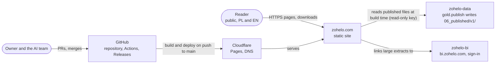

# zohelo.com: architecture

The public brand site ("Polska w danych / Poland in data") in the repository
[zohelo/zohelo](https://github.com/zohelo/zohelo). This view is the Architect's (docs/team.md, Architect; O20): current
state, target state, the gap, and the fitness checks that keep the site on the target. The platform overview is
[../architecture.md](../architecture.md); the published contract it reads is [../published.md](../published.md).

## Current state (zohelo main, 2 November 2026)

- **Static, pre-rendered site.** React Router 7 in framework mode with `ssr: false` and `prerender()`
  (`react-router.config.ts`): every page in `src/site.config.ts` in Polish (`/…`) and English (`/en/…`), one page per
  published KPI (`/indicators/<kpi_key>`), per voivodeship (`/regions/…`) and per portfolio case study, plus 404.
  56 URLs in the sitemap on the fixture layer. No server code at request time, no Pages Functions.
- **Data at build time only.** `scripts/fetch-published.ts` copies `06_published/v1/` (catalog, `kpi/*/latest.json`,
  `kpi/*/series.parquet`, `geo/*.geojson`, `feed/*`) with the read-only lakehouse key (D7, O7) into `.published/`
  before the build; without the key it copies `fixtures/published/` (PR checks), and on `main` it fails instead
  (`--require`). Loaders read those files through `src/published.ts`; parquet is read with hyparquet. After the build,
  `scripts/` write 404, sitemap, RSS, calendar and `/downloads/` (series CSV and Parquet up to 200 kB per file).
- **Charts are client-only.** `@zohelo/design/visuals` (Vega, Vega-Lite, vega-embed) renders only through `.client`
  modules after hydration (D25): `SeriesChart`, `MapChoropleth`, `SampleChart`. Pages ship their numbers in the HTML
  (tiles, tables) and the chart arrives as one lazy chunk.
- **Design system in the same repo.** `packages/design` (`@zohelo/design`, workspace package): tokens and theme CSS,
  fonts, components (`KpiTile`, `DataTable`, `SourceFooter`, …), number and date formats (`format.ts`) and the
  Vega spec builders. zohelo-bi consumes it as a GitHub Release tarball (D3, `design-release.yml`). The site forces
  the light theme until components use token classes (D21).
- **Hosting.** Cloudflare Pages project `zohelo` (zohelo.com, www.zohelo.com), deployed by `deploy.yml` on every
  push to `main` (setup as code in `scripts/cloudflare-setup.ts`, a smoke check for "Polska w danych", a GitHub
  Release per production deploy); a manual run on a branch deploys a preview. Public, no sign-in.
- **Measured weight** (fixture build of main, gzip, JS + CSS a page loads): pages without a chart about 160 kB
  (`entry.client` 69 kB, router chunk 44 kB, `root.css` 41 kB); pages with a chart about 460 kB, of which the Vega
  chunk is 294 kB (855 kB raw). The home page loads the chart chunk (chart of the day).

### System context (C4 level 1)

### Containers (C4 level 2)

## Target state

1. **Fresh without a code change.** A successful `gold.publish` in zohelo-data rebuilds and deploys the site, so
   published numbers reach zohelo.com within one pipeline cycle. Today the site shows the published layer of the
   last merge to zohelo `main`: a fix in the data (for example zohelo-data#2449, merged 2 Nov) reaches readers only
   with the next unrelated merge.
2. **Light pages, charts on demand.** Every page is readable without JavaScript (numbers in HTML, D25); the chart
   code loads only where a chart is visible, and a chart page stays within the page-weight budget below. Vega
   remains the chart engine until a measured alternative is lighter at equal function; any switch is an ADR.
3. **One front-end foundation for three products.** `@zohelo/design` is the single source of tokens, components,
   formats and chart style for zohelo.com, zohelo-bi and the data portal, versioned and released from this repo;
   dark mode arrives with token adoption (D21). Architecture backlog item 6, zohelo-data#2448.
4. **Contract-driven reads.** The site reads only what docs/published.md declares, validates it at build time against
   the published JSON Schemas (as zohelo-bi does, D24), and its fixtures follow the same rules (D26), so a contract
   change fails a PR check, not the production pre-render.
5. **Properties checked by machine** (fitness checks below), each in the `check` workflow or the deploy.

## Gap

| # | Gap | Proposed work | Size |
|---|---|---|---|
| G1 | No rebuild after `gold.publish`; site data is as old as the last zohelo merge | Epic: after a green `gold.publish`, dispatch zohelo `deploy.yml` on `main` (the zohelo-automation app token; `workflow_dispatch` already exists), with the publish run linked in the deploy summary | S–M, crosses repos |
| G2 | No page-weight or bundle budget; the Vega chunk (294 kB gz) loads on the home page | Epic: a build-time budget check (below) in `check.yml`; then decide whether the home page's chart of the day loads the chart chunk only when scrolled into view | S + M |
| G3 | The site does not validate published JSON against the zohelo-data schemas | Task: build-time schema validation in `fetch-published.ts` (mirror of zohelo-bi, D24) | S |
| G4 | Light theme forced (D21); components still use literal classes in places | Covered by the Designer's design-system work and zohelo-data#2448 | — |
| G5 | No accessibility check in CI | Epic with the Designer: an automated axe pass over the pre-rendered pages, zero serious or critical findings | M |

The Epics for G1, G2, G3 and G5 are proposed to the Product Owner on Product inbox #2074.

## Fitness checks

| Property | Threshold | Where it runs | Today |
|---|---|---|---|
| JS + CSS a page without a chart loads (gzip) | ≤ 200 kB | `check.yml`, new budget step over `build/client` (G2) | none (measured 160 kB) |
| JS + CSS a chart page loads (gzip) | ≤ 500 kB | same step (G2) | none (measured 460 kB) |
| Chart chunk only on pages that render a chart | the Vega chunk is not referenced by `/sources`, `/indicators`, `/portfolio`, `/changes` | same step (G2) | none |
| Download files | ≤ 200 kB each (`DOWNLOAD_LIMIT`) | `scripts/downloads.ts` in every build | yes |
| Published files read | `latest.json` ≤ 100 kB (D22); series and geo limits of docs/published.md | `gold.publish` in zohelo-data | yes (writer side) |
| Published JSON matches the contract | valid against `kpi_latest.schema.json` and the other published schemas | `fetch-published.ts` (G3) | fixtures only |
| `main` never ships fixture numbers | deploy fails without the read key | `deploy.yml` (`--require`) | yes |
| Workflow actions pinned to a commit | every `uses:` pinned | `check.yml`, `scripts/check-pins.sh` | yes |
| Accessibility | no serious or critical axe findings on pre-rendered pages | `check.yml` (G5) | none |
| Data freshness on the live site | site data no older than the last green `gold.publish` plus one deploy | deploy after publish (G1), Quality Engineer sprint check | none |
