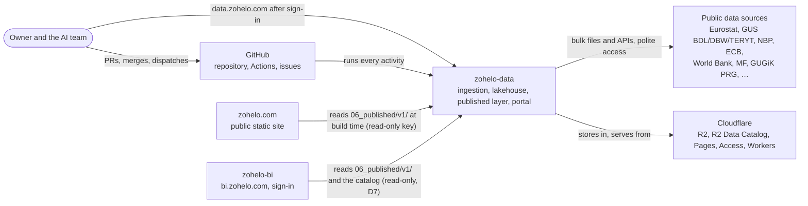
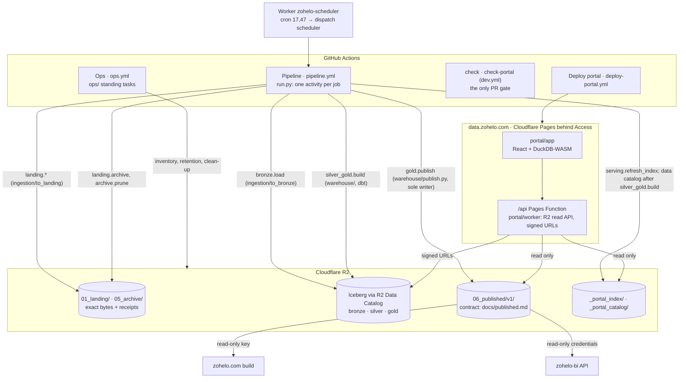

# zohelo-data: architecture

The data platform in the repository [zohelo/zohelo-data](https://github.com/zohelo/zohelo-data): ingestion, the
lakehouse, the published layer and the internal portal data.zohelo.com. This view is the Architect's (docs/team.md,
Architect; O20): current state, target state, the gap, and the fitness checks that keep the platform on the target.
The overview of stages and layers is [../architecture.md](../architecture.md); activities and workflows are in
[../operating.md](../operating.md); the contract readers build against is [../published.md](../published.md).

## Current state

- **Free stack.** Cloudflare R2 (buckets `zohelo-landing-prod` for Landing and Archive, the lakehouse bucket for
  Iceberg tables and published files), R2 Data Catalog (Apache Iceberg REST) and R2 SQL, GitHub Actions as the only
  compute and orchestrator, Cloudflare Pages for the portal, one Cloudflare Worker as the scheduler's clock. Anything
  beyond a free tier is an owner decision (AGENTS.md).
- **One entry point, one activity per job.** `run.py` plans a run and executes one activity (`<stage>.<verb>`,
  docs/operating.md); the Pipeline workflow runs one job per activity with the shared steps of
  `.github/actions/activity/`. An activity runs only when it is implemented and listed under `activities:` in
  `ingestion/sources/<source>.yaml`, `warehouse/warehouse.yaml` or `portal/portal.yaml` — that list, merged to
  `main`, is its authorization. Results go to run annotations and the job summary; there are no state or run-record
  files (state lives in Landing receipts and the Iceberg tables).
- **Ingestion.** 21 source configurations. Source → Landing by a source folder (`ingestion/to_landing/<s>/`) or a
  shared pattern (`extraction.kind`, e.g. `bulk_file`); Landing keeps exact source bytes with receipts and is never
  overwritten. Landing → Bronze (`ingestion/to_bronze/<s>/`) writes source-faithful Iceberg tables, then Landing files
  move to the Archive (copy, SHA-256 verify, delete; retention per source). Eurostat and GUS BDL write Silver together
  with Bronze per entity (#875).
- **Warehouse.** The dbt project in `warehouse/` (dbt-duckdb writing Iceberg through the R2 catalog) builds Silver and
  Gold v1 (conformed dimensions, facts by frequency, `metrics_*` models; docs/model.md), changed-only by default, daily
  at 07:30 UTC; full-rebuild models carry row ceilings (`full_rebuild:` in `warehouse.yaml`, policy #822, D28).
  `warehouse/catalog.py` publishes the data catalog for the portal after each production build.
- **Published layer.** `gold.publish` (`warehouse/publish.py`) is the sole writer of `06_published/v1/` (D5): catalog,
  manifest, status, `kpi/<kpi_key>/latest.json` and `series.parquet`, `geo/<level>.geojson`, feeds. Objects are checked
  against the JSON Schemas (`schema_checked`, D27) and against most size limits of docs/published.md before writing.
  Readers: zohelo.com at build time with the read-only key, zohelo-bi through its API with read-only credentials (D7),
  and the portal through `/api/published/v1/`.
- **Portal data.zohelo.com.** A React + DuckDB-WASM app (`portal/app`) on Cloudflare Pages behind Cloudflare Access
  (one-time PIN to the allowed emails); its `/api` is a Pages Function wrapping the R2 read API
  (`portal/worker/src/index.js`): file index `_portal_index/v1/`, data catalog `_portal_catalog/v1/`, the published
  layer, and signed short-lived download URLs. Writer credentials never reach the browser. The DuckDB engine loads from
  jsDelivr at run time. Deployed by `deploy-portal.yml` on pushes to `main` that change `portal/app` or `portal/worker`.
- **Scheduling.** Schedules are declared in the source and warehouse YAML; `run.py schedule` dispatches due runs.
  GitHub's own cron drops many events (#802), so the Worker `zohelo-scheduler` dispatches the scheduler (cron `17,47 * * * *`) as the `zohelo-automation` app; `scheduler_trigger heartbeat` checks it daily.
- **Operations.** `ops/` holds the standing tasks (inventory, retention and clean-up with `--apply`/`--delete` only
  under an owner decision, security alerts, tracker, backlog sync, release notes); five of them run on Monday
  schedules from `ops.yml`. Failed Pipeline runs open `alert` Bugs (`notify_failure`).
- **One gate.** The `check` job of `dev.yml` (compile, ruff, yamllint, sqlfluff, dbt parse, configuration and
  repository rules in `ops/repo_check.py`, PR body rule) and `check-portal` (lint, types, build and the axe-core
  accessibility scan of the portal, #2499) are the only CI; there are no committed tests (AGENTS.md).

### System context (C4 level 1)

### Containers (C4 level 2)

## Target state

1. **Every source in every layer, on a schedule** (Mandate): each source in `ingestion/sources/` has Landing, Bronze,
   Silver and Gold models and a green scheduled full-dataflow run; sources with no route are parked for the owner.
   Today GUS DBW, dane.gov.pl, GLEIF and MF Biała Lista stop at Bronze (docs/architecture.md, "Layers").
2. **Published layer as a versioned product.** `06_published/v1/` changes only additively; a breaking change is a new
   `v2/` written next to `v1/` (expand/contract, D6) until every reader has moved. Every limit and schema in
   docs/published.md is enforced by the writer, and each reader validates what it reads (D24) against schema copies
   that a check keeps equal to zohelo-data's.
3. **Readers learn of new data.** A green `gold.publish` is a signal the readers can act on (zohelo.com rebuild,
   zohelo.com view G1), so published numbers reach users within one pipeline cycle.
4. **Storage within the free tier, by machine.** Storage per bucket and folder, Iceberg file counts and snapshot
   counts are measured on a schedule with thresholds, not only when someone runs `platform_inventory`.
5. **Portal without third-party run-time dependencies for its core.** The query engine is served from the portal's
   own origin (a build with the bundled engines already works locally, #2555), so data.zohelo.com does not depend on a public CDN.
6. **Shared tooling stays shared.** Files kept byte-identical across the three repos (the axe-core runner `a11y.mjs`,
   `branch-cleanup.yml`, the backlog validator run at a pinned commit) are checked for drift by machine.

## Gap

| # | Gap | Proposed work | Size |
|---|---|---|---|
| G1 | Four sources stop at Bronze; Silver/Gold coverage is partial | Source Epics already in the backlog (Developer 2); the tracker (`ops/tracker.py`) shows the cells | — |
| G2 | `catalog/catalog.json` ≤ 2 MB gzip (docs/published.md) is not enforced by `gold.publish`; the other limits are | Task: a `CATALOG_LIMIT` check in `warehouse/publish.py` next to `LATEST_LIMIT` | S |
| G3 | No contract versioning rule written down; readers' schema copies can drift | ADR: published-layer versioning (additive within `v1`, `v2/` side by side for breaking changes, deprecation window), then a drift check in zohelo and zohelo-bi (zohelo.com view G3) | ADR + S |
| G4 | No publish signal to readers | Covered by the zohelo.com view G1 (ADR there); zohelo-data side: `gold.publish` writes `generated_at` (exists) and, if the ADR picks dispatch, the cross-repo dispatch | — |
| G5 | Storage and file growth are checked only on demand (`platform_inventory` is not scheduled; compaction is off since #875, so small files accumulate) | Task: schedule `platform_inventory` weekly in `ops.yml` with thresholds (free tier 10 GB: warn at 8 GB, fail at 10 GB; files per table, proposed warn at 1,000) | S |
| G6 | data.zohelo.com loads DuckDB-WASM from jsDelivr at run time | Task: bundle the engine in the portal build (a local build with it works, #2555), measure the deploy size against the Pages limits | M |
| G7 | The shared a11y runner is copied byte-identical in three repos with no drift check (tech-debt) | Task: a check that compares the blob of each copy with zohelo-data's, in each repo's `check` | S |

The Epics and Tasks for G2, G3, G5, G6 and G7 are proposed to the Product Owner on Product inbox #2074.

## Fitness checks

Thresholds marked *proposed* are decided by the Task or ADR that builds the check, then recorded in docs/decisions.md.

| Property | Threshold | Where it runs | Exists |
|---|---|---|---|
| Published `latest.json` | ≤ 100 kB (D22) | `gold.publish` (`LATEST_LIMIT`) | yes |
| Published series, geo, status | limits of docs/published.md | `gold.publish` (`SERIES_LIMIT`, `GEO_LIMITS`, `STATUS_LIMIT`) | yes |
| Published catalog | ≤ 2 MB gzip | `gold.publish` (G2) | no |
| Published JSON matches the schemas | `schema_checked` on every object written; `repo_check` checks the contract files | `gold.publish`, `check` | yes |
| Full-rebuild Gold/Silver models | row ceiling per model; warn above, fail above twice (D28) | `silver_gold.build`, `repo_check` (`full_rebuild`) | yes |
| Storage within the free tier | *proposed*: warn at 8 GB, fail at 10 GB across buckets | scheduled Ops `platform_inventory` (G5) | on demand only |
| Iceberg small files | *proposed*: warn above 1,000 data files per table | same run (G5) | no |
| Orphan files | none older than 48 h | Ops `orphan_files --delete`, Mondays | yes |
| Snapshots | 1 kept, older expired after 1 h (#822) | catalog maintenance; `expire_snapshots` | yes |
| Scheduler clock | ≥ 40 dispatches in 24 h | Ops `scheduler_trigger heartbeat`, daily | yes |
| Workflows | exactly five; actions pinned to a commit; hashed pip installs | `repo_check` | yes |
| Secrets and dependency alerts | every open alert has a Bug | Ops `security_alerts apply`, Mondays | yes |
| Portal accessibility | no serious or critical axe-core element outside the baseline; every baseline entry cites a Bug | `check-portal` (`portal/app/a11y`, #2499) | yes |
| Shared files identical across repos | same blob as zohelo-data's copy | each repo's `check` (G7) | no |
